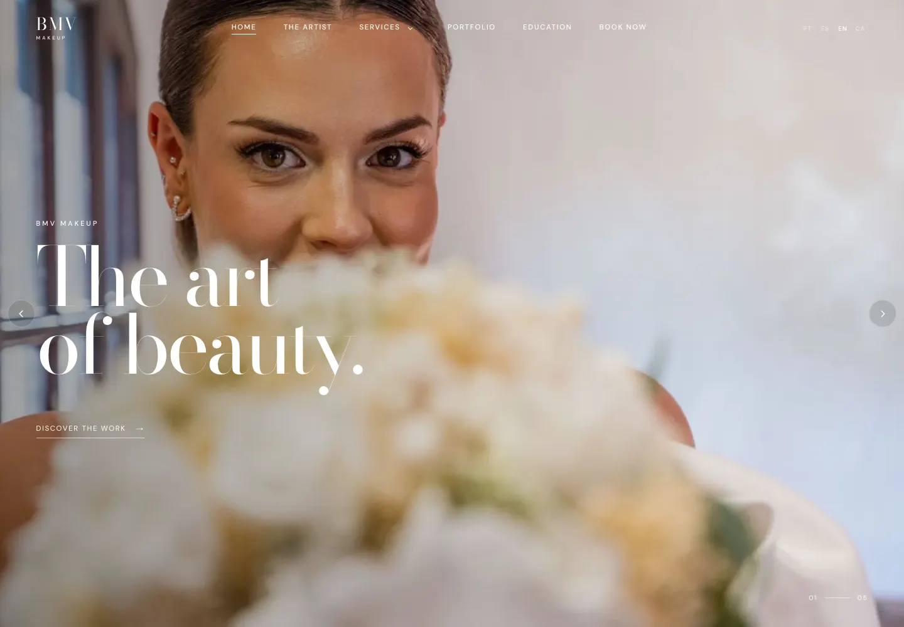
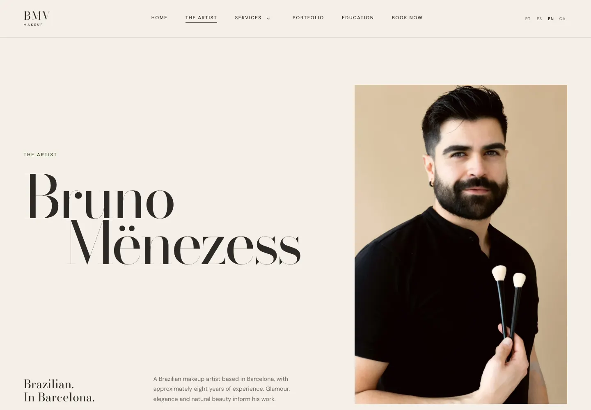
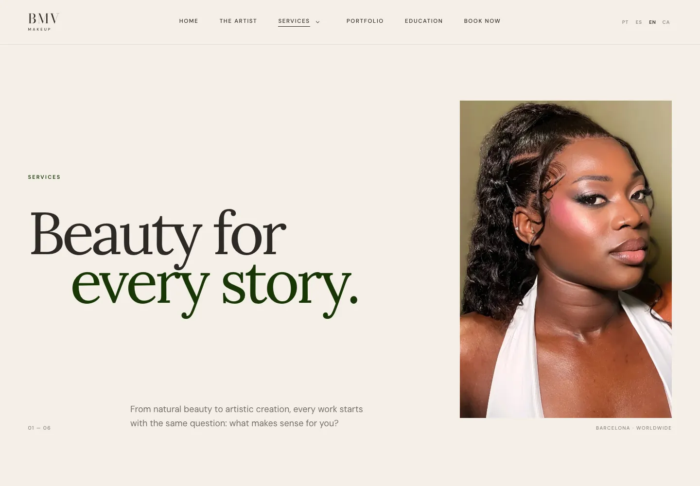
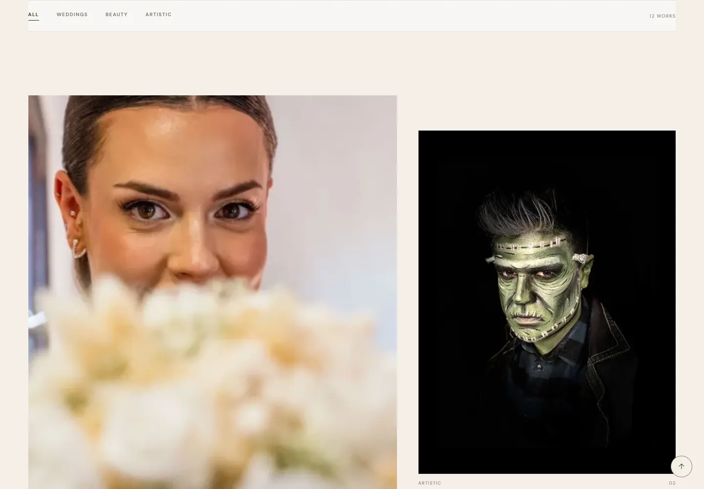
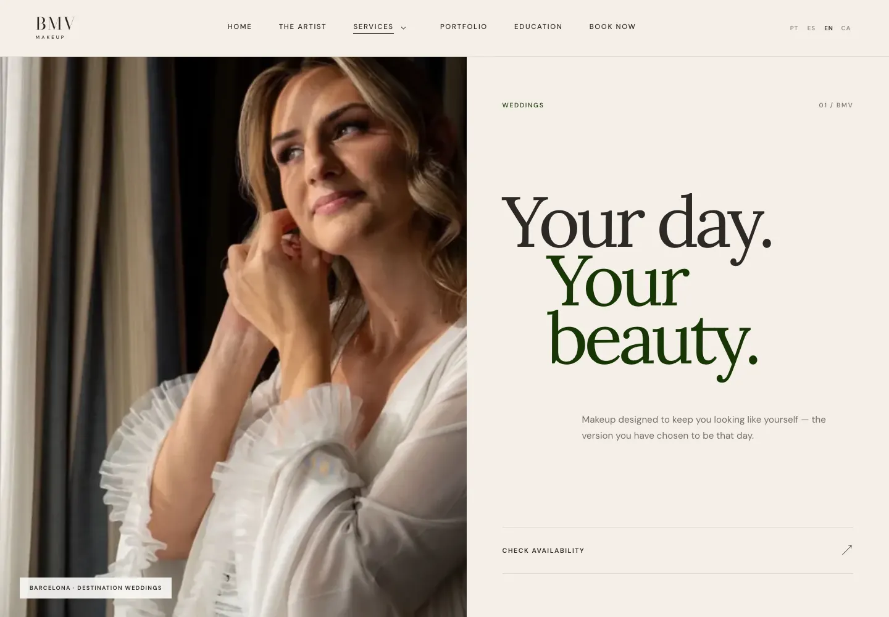
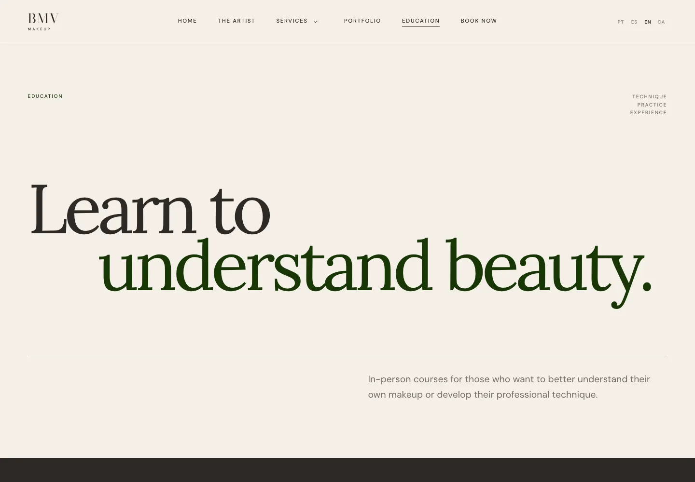
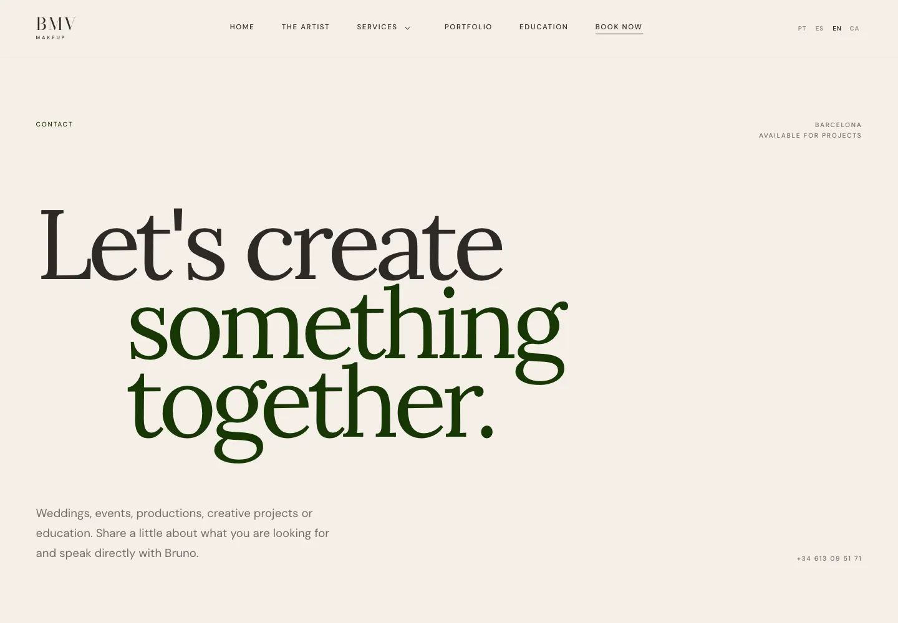
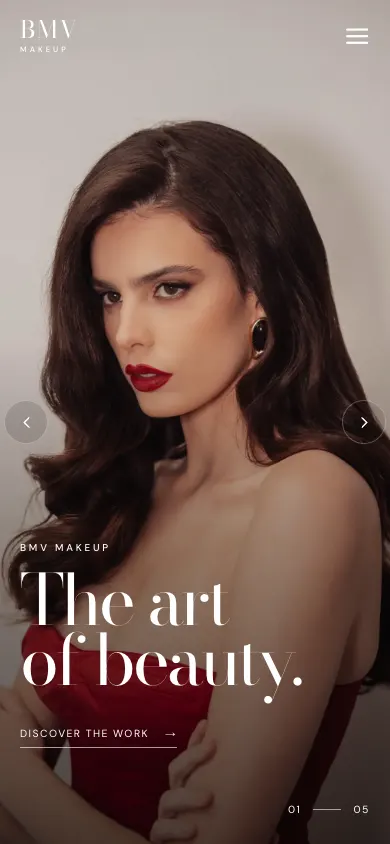
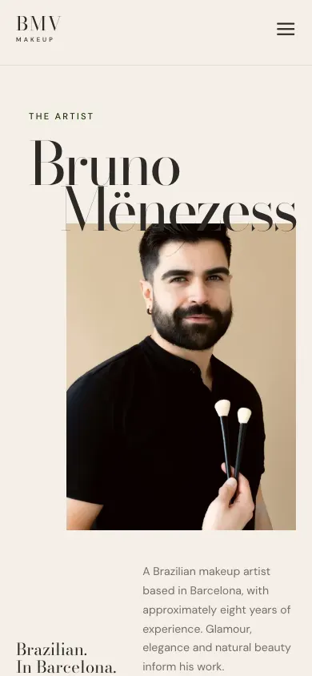
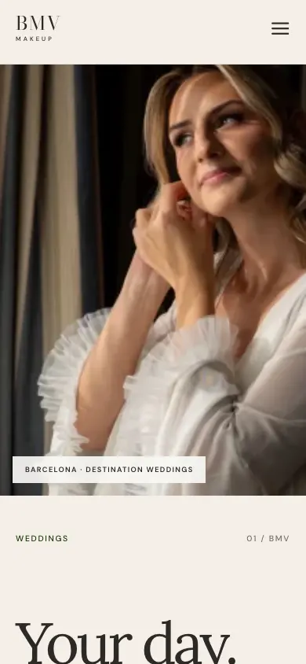

<h1 align="center">BMV Makeup</h1>

<p align="center">
  An editorial portfolio and professional website for <strong>Bruno Mënezess</strong>, a makeup artist based in Barcelona.<br />
  Photography, personal storytelling and a thoughtful booking journey in four languages.
</p>

<p align="center">
  <a href="https://www.bmvmakeup.com/"><strong>Visit the website</strong></a>
</p>

<p align="center">
  
  
  
  
  
  
  
</p>

## Overview

BMV Makeup presents Bruno’s work through a photography-led experience with an editorial visual identity. The site brings together his story, bridal, beauty and artistic makeup, professional education and contact information. Its purpose is to help visitors discover his approach, explore relevant work and start a personal conversation.

The application is a React single-page website with a small server-side Instagram integration. It does not require a database, CMS or separate Java backend.

## Screenshots

Real captures from the local production build, in English. Optimized WebP files are kept in [`docs/screenshots/`](docs/screenshots/); desktop captures use a 1440 × 1000 viewport and mobile captures use 390 × 844.

<table>
  <tr><th>Home</th><th>About</th></tr>
  <tr>
    <td align="center"></td>
    <td align="center"></td>
  </tr>
  <tr><th>Services</th><th>Portfolio</th></tr>
  <tr>
    <td align="center"></td>
    <td align="center"></td>
  </tr>
  <tr><th>Weddings</th><th>Education</th></tr>
  <tr>
    <td align="center"></td>
    <td align="center"></td>
  </tr>
</table>

<p align="center">
  
</p>

<p align="center">
  
  
  
</p>

## Features

- Seven public pages: Home, About, Services, Weddings, Portfolio, Education and Contact, plus a localized 404.
- Five approved Hero photographs for desktop and five for mobile, with automatic transitions, circular manual navigation and keyboard-accessible controls.
- A filterable portfolio covering Weddings, Beauty & Social and Artistic makeup.
- Bridal process, testimonials and recommended professionals with direct section navigation.
- Course details, prices and contact actions; booking conversations use WhatsApp rather than an embedded payment or calendar system.
- Smart Sticky Header, current-page indicators, accessible desktop submenus and an expandable mobile navigation dialog.
- Portuguese, English, Spanish and Catalan translations with persistent language selection.
- Scroll reveals, continuous editorial marquees and reduced-motion alternatives.
- Instagram posts fetched through a server-side endpoint, with a usable fallback when the feed is unavailable.

## Stack

| Area | Implementation |
| --- | --- |
| Interface | React 19, JavaScript and JSX |
| Build | Vite 8, `@vitejs/plugin-react` |
| Routing | React Router DOM 7 |
| Styling | CSS Modules, global design tokens, responsive CSS |
| Localization | i18next and react-i18next |
| Icons | React Icons |
| Instagram | Native Fetch API, Vercel Node.js functions and optional encrypted private Blob storage |
| Quality | ESLint, Node.js test runner, Playwright |
| Hosting | Vercel |

Bodoni Moda, DM Sans and Lora are served locally as WOFF2 fonts. Their licenses are included in `frontend/public/fonts/`.

## Repository structure

```text
bmv-makeup/
├── docs/
│   ├── screenshots/             # Optimized captures used by this README
│   ├── architecture.md
│   ├── design-system.md
│   ├── instagram.md
│   ├── maintenance.md
│   └── validation.md
├── frontend/
│   ├── api/                     # Public feed and authenticated maintenance endpoint
│   ├── image-sources/           # Retained sources; excluded from public assets
│   ├── public/
│   │   ├── assets/images/       # Semantic folders; variants beside each master
│   │   ├── fonts/
│   │   └── favicon.svg
│   ├── scripts/                 # Translation, image integrity and server integration tests
│   ├── server/instagram/        # Private storage, encryption and token maintenance
│   ├── src/
│   │   ├── components/          # Common controls, layout and page sections
│   │   ├── data/               # Responsive image metadata
│   │   ├── i18n/locales/        # pt, en, es, ca
│   │   ├── pages/
│   │   ├── styles/
│   │   ├── App.jsx
│   │   └── main.jsx
│   ├── tests/                   # Browser tests and approved asset fixture
│   ├── index.html              # Initial HTML and crawler-visible metadata
│   ├── package.json
│   ├── playwright.config.js
│   ├── vercel.json
│   └── vite.config.js
└── README.md
```

## Architecture and Instagram

React Router composes pages from reusable sections. Shared controls own navigation, image delivery, document metadata, scroll restoration and reveal behavior. Content comes from translation dictionaries and local assets.

The Home requests `/api/instagram`. The server function defaults to the existing server environment token and requests profile/media data from Meta. An opt-in private Blob provider and a separate authenticated daily maintenance job are prepared for automatic renewal; both remain inactive until explicitly configured. It returns a normalized feed and cache headers; the token is never sent to the browser. Ordinary Vite development and preview servers do not execute Vercel functions, so the existing feed fallback is expected there. Use Vercel for function integration checks; the maintenance job explicitly rejects Preview and local execution.

See [architecture](docs/architecture.md) and [Instagram maintenance](docs/instagram.md) for the request flow, cache policy, configuration and activation steps.

## Internationalization

All four languages share the existing routes. The selected language is stored under `bmv-language` in localStorage; English is the initial default and Portuguese is the translation fallback. Language changes update visible copy, accessibility labels, date formatting and the document’s `lang` attribute. Instagram captions retain their original language.

Language-specific URLs are not implemented. Valid `hreflang` requires distinct language URLs and matching initial HTML; this remains a documented future task.

## SEO, accessibility and images

The initial `index.html` contains canonical, Open Graph and Twitter card tags for social crawlers without JavaScript. The 1200 × 630 sharing image uses Bruno’s About portrait. SPA navigation localizes titles, descriptions, canonical URLs and document language in the browser. This does not constitute server rendering of route-specific content.

Navigation supports keyboard focus and Escape, current-page semantics and separate expand/navigation controls. The mobile dialog manages focus and background scrolling. Images have translated alternative text where meaningful; decorative Hero imagery is hidden from assistive technology. Motion respects `prefers-reduced-motion`.

Photographs use semantic paths, WebP masters and colocated responsive variants, with dimensions and byte sizes in `src/data/image-metadata.json`. `OptimizedImage` supplies `srcset`, `sizes`, intrinsic dimensions, asynchronous decoding and lazy loading. The Hero uses device-specific `<picture>` sources, one high-priority initial slide and a viewport-aware Home preload. Shared photographs have one master; the social JPEG retains its stable URL.

## Local development

Prerequisites: Node.js **20.19+ or 22.12+**, compatible with the installed Vite version, and npm.

```sh
git clone https://github.com/lorenasferreira/bmv-makeup.git
cd bmv-makeup/frontend
npm ci
npm run dev
```

Vite prints the local address, normally `http://localhost:5173`. No secret is required to develop the interface or run the tests.

```sh
# Production build and local preview
npm run build
npm run preview
```

## Environment and tooling variables

Only variable names are documented; credentials must stay outside version control.

| Name | Scope | Purpose |
| --- | --- | --- |
| `INSTAGRAM_ACCESS_TOKEN` | Server only | Existing feed credential; preserved during migration |
| `INSTAGRAM_TOKEN_SOURCE` | Server only | Select the existing environment credential or the opt-in encrypted Blob record |
| `CRON_SECRET` | Server only | Authenticate the prepared daily maintenance endpoint |
| `INSTAGRAM_TOKEN_ENCRYPTION_KEY` | Server only | Encrypt the private token record |
| `INSTAGRAM_TOKEN_AUTOMATION_ENABLED`, `INSTAGRAM_TOKEN_REFRESH_ENABLED` | Server only | Separate activation of checks and real renewal; disabled by default |
| `BMV_BROWSER_PATH` | Tests, optional | Use an installed browser executable |
| `BMV_BROWSER` | Tests, optional | Select a Playwright browser engine |
| `CI` | Test runner, optional | Reject accidentally focused tests in CI |

The full list of Blob authentication, bootstrap metadata, expiry timestamps and optional monitor variables is documented in [Instagram configuration](docs/instagram.md#configuration-to-perform-later-in-vercel). There are no required `VITE_` environment variables. Never expose the Instagram token through a browser-prefixed variable.

## Tests and quality checks

Run from `frontend/`:

```sh
npm run lint
npm run build
npm run test:i18n
npm run test:images
npm run test:instagram
npx playwright install chromium
npm run test:behavior
```

`npm test` runs translation, image integrity, simulated Instagram server tests and browser tests. Playwright starts an isolated Vite server on port 4273 and mocks the Instagram network boundary; no live account or credentials are required. For an existing browser installation, set `BMV_BROWSER_PATH` when invoking the tests. Failure screenshots and traces are ignored by Git.

Coverage includes routes in all languages, responsive layouts, navigation and focus, image decoding and approved Hero order, social metadata before JavaScript, Instagram success/failure states and equivalent marquee movement. See [test documentation](frontend/tests/README.md) and the [validation record](docs/validation.md).

## Deployment

The Vercel project should use `frontend/` as its root, the Vite build (`npm run build`) and `dist/` as its output directory. `frontend/api/instagram.js` provides the public feed. `frontend/vercel.json` retains the SPA rewrite and prepares a daily authenticated maintenance schedule; token automation and refresh remain disabled until explicitly configured.

Configure the server token in the appropriate Vercel environment using the project settings. Validate deep links, the live feed, social image access and sharing previews after publication. Build output and local previews do not verify production credentials or Meta authorization.

## Maintenance

- Keep the professional name exactly **Bruno Mënezess** in all public copy.
- Preserve the manually authored initial metadata; image-path maintenance must not overwrite its descriptions.
- Keep approved Hero order and device separation; rerun image tests after photography changes.
- Use descriptive kebab-case filenames and colocated `-480w.webp` / `-960w.webp` variants. Shared images belong under `shared/`.
- Keep image metadata and the approved test fixture synchronized when an approved photograph changes.
- Review desktop/mobile layouts, translations, keyboard navigation and reduced motion after UI updates.
- Token renewal, encrypted private storage, daily scheduling and optional monitoring are implemented locally with simulated tests. External services, production activation and a real refresh still require authorization.

Detailed procedures: [maintenance](docs/maintenance.md). Visual reference: [design system](docs/design-system.md).

## Credits

Designed and developed by **[Lorena Ferreira](https://lorenaferreira.dev)** for **BMV Makeup — Bruno Mënezess**.

Client photography and brand assets are included for this website; no redistribution license is granted by this README.
